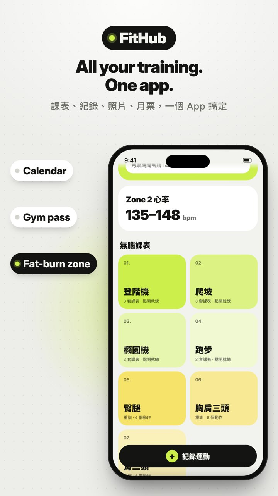
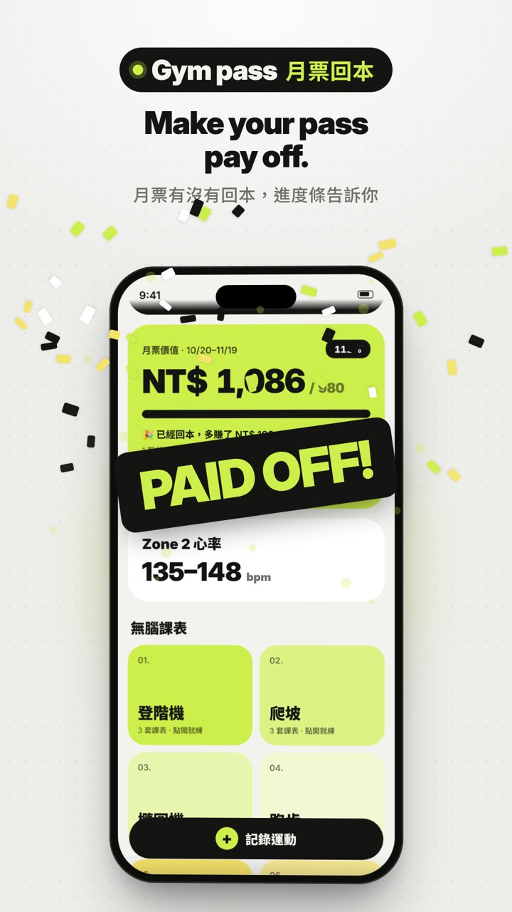

# Evelyn's Portfolio

我用產品思維、搭配 AI 做出來的作品。每個專案都附上它的起點、開發歷程與取捨。

## 作品

### [FitHub](fithub/) · 讓月票花得值得的運動紀錄 App

> 少想一點，多練一點，而且每一次練習都「算數」。

辦了一張健身房月票，卻不知道有沒有回本、到了健身房也不知道要練什麼——所以我用 4 週、78 次更新做了 FitHub：打開就有課表跟著練，練完一鍵記錄，月底看得到月票有沒有回本。

- [專案介紹](fithub/) · [30 秒介紹影片](fithub/fithub-intro.mp4) · [開發歷程 PDF](fithub/FitHub-產品開發歷程.pdf) · [線上體驗](https://fithub-ten-wheat.vercel.app)

 

---

各專案的程式碼為私人專案，未公開。
