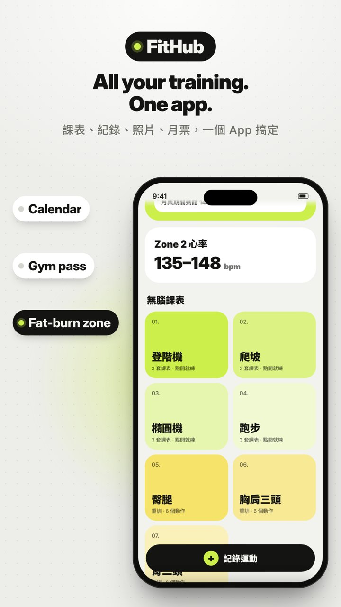
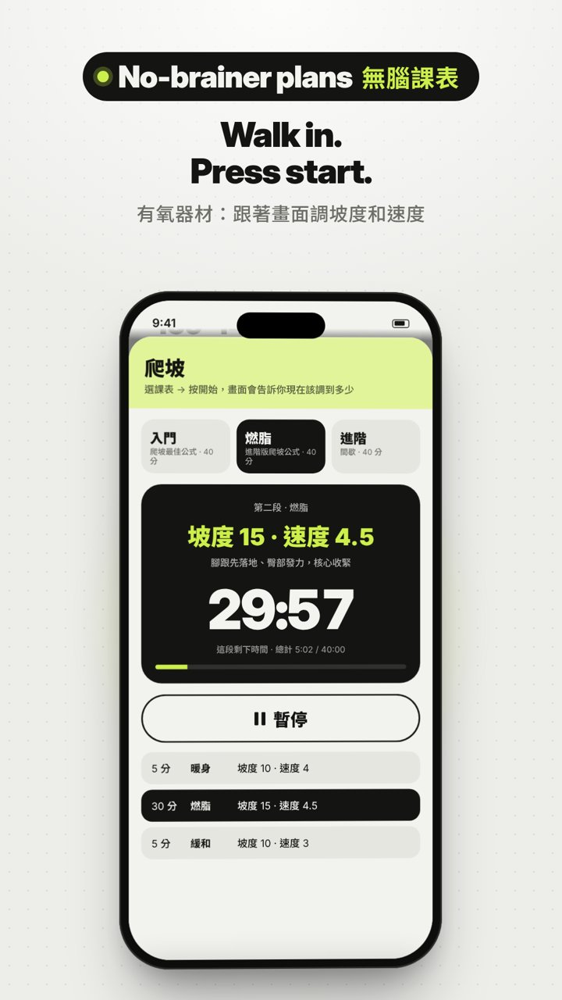
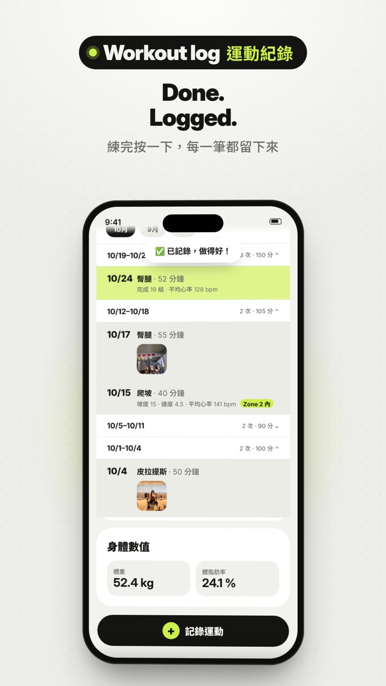
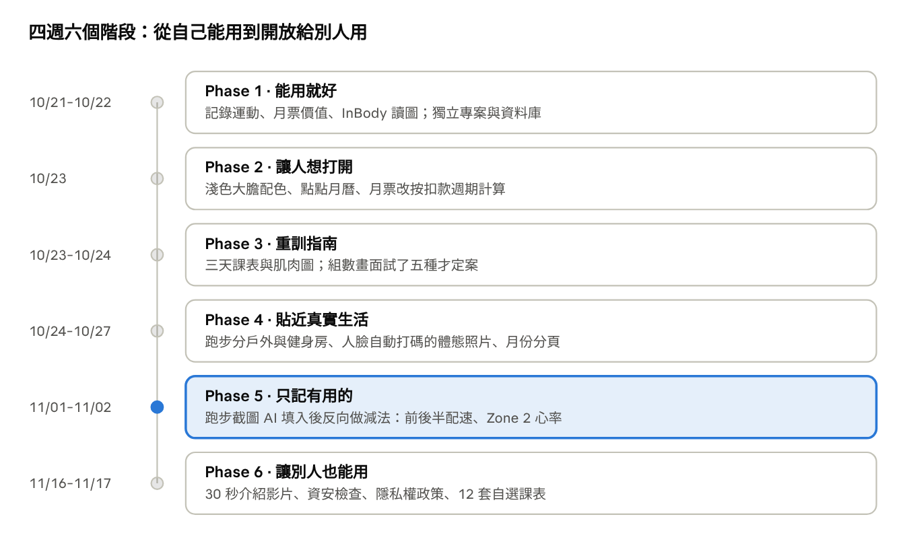
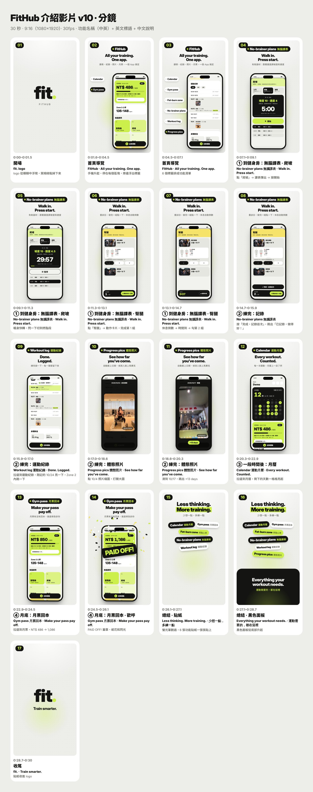

# FitHub · 讓月票花得值得的運動紀錄 App

> 少想一點，多練一點，而且每一次練習都「算數」。

FitHub 幫「有買健身房月票、但常常不知道今天要練什麼」的人：走進健身房打開就有課表可以跟，練完一鍵記錄，月底看得到月票有沒有回本。

- **線上體驗：** [fithub-chogu.vercel.app](https://fithub-chogu.vercel.app)
- **介紹影片（30 秒）：** [fithub-intro.mp4](fithub-intro.mp4)
- **開發期間：** 2026/10/21 – 11/17，約 4 週，78 次版本更新
- **角色：** 一人包辦產品構想、需求定義、設計決策與驗收，以 AI（Claude）作為開發夥伴

  
  
  
  

## 為什麼做這個

2026 年 10 月下旬，薔琵颱風來之前，家附近開了一間按分鐘計費的健身房：平日晚上每分鐘 1.5 元、其他時段 1.2 元，也可以辦 NT$980 的月票。我猶豫了很久，最後決定「衝個月票」，想說繳了錢就會為了不浪費多去幾次。

辦了之後發現三個問題，而且幾乎每個辦過健身房會員的人都有：

- **花了錢卻看不到回報：** 每次都能算出「這次省了多少」，卻沒有地方幫我加總。
- **到了健身房不知道要練什麼：** 每個部位做一點沒效果；想試新器材又不敢用，只好對照機器上的肌肉圖，或滑 IG、YouTube 找影片。分鐘計費的話，滑越久越心痛。
- **紀錄分散、照片尷尬：** 相簿裡一堆健身自拍很佔空間，被別人看到很尷尬，想比較體態變化又要自己找日期。

## 主要功能

依一次健身的使用旅程排列：

| 時刻 | 功能 | 解決什麼 |
|---|---|---|
| 到健身房 | **無腦課表**：12 套課表（爬坡、登階機、橢圓機、跑步，8 種重訓日），畫面直接告訴你現在該調到多少；重訓每個動作有示範圖、肌肉圖、組數圈圈與 1 分鐘休息計時 | 不用自己想今天練什麼 |
| 練完 | **一鍵記錄**：跑步截圖丟進來，AI 自動填好距離、心率、每公里分段 | 記錄不花時間 |
| 練完 | **體態照片**：手機上先自動偵測人臉打馬賽克、壓上日期才存，原圖不上傳 | 留下進步，又不尷尬 |
| 一段時間後 | **運動月曆**、**Zone 2 燃脂心率**：填安靜與最高心率就算出燃脂區間，每筆有氧紀錄自動標示是否在區間內 | 看得到累積與進步 |
| 月底 | **月票回本**：依時段費率換算每次到館的價值，進度條跑滿就回本 | 花的錢值不值得一目了然 |

## 開發歷程

1. **能用就好：** 記錄、月票價值、InBody 讀圖。抓到單位誤解（「1.2 分鐘/元」其實是「每分鐘 1.2 元」），以及運動和到館重複計算的問題，定下「月票只算在館時間」。
2. **讓人想打開：** 淺色大膽配色、大按鈕、點點月曆、月票改按實際扣款週期。
3. **重訓指南：** 「一組一組練」的畫面試了五種才定案。學到使用者要的是「打勾」和「休息」分開，而不是更聰明的合併按鈕。
4. **貼近真實生活：** 跑步分戶外與健身房、人臉自動打碼的體態照片、月份分頁與滑動月曆；解決 iPhone 下載與資料庫權限的問題。
5. **只記有用的：** AI 讀截圖能填 10 個欄位，但我只留下能拿來比較進步的那幾個，分段收成「前半 vs 後半」一行。
6. **讓別人也能用：** 30 秒介紹影片（改了 10 版）、資安檢查、忘記密碼與刪除帳號、隱私權政策、12 套自選課表。

完整的故事與每個階段的取捨：[FitHub 產品開發歷程（PDF）](FitHub-產品開發歷程.pdf)

## 做產品的四個原則

1. **自己就是第一個使用者，但用真實場景驗收：** 每一版都帶去健身房用過才提下一個需求。
2. **少一個欄位，就多一分會被堅持使用的機會：** 問的不是「能不能記」，而是「以後會不會回來看」。
3. **隱私先於便利：** 臉部打碼在手機上完成、照片沒有公開網址、介紹影片全用示範資料。
4. **用使用旅程排優先順序：** 「到健身房 → 練完 → 一段時間後 → 月底」決定了首頁、記錄流程和影片的順序。

## 技術

React 19 · TanStack Start · Tailwind · Firebase（登入、Firestore）· Claude API（截圖讀取）· MediaPipe（手機端人臉偵測）· Vercel

程式碼為私人專案，未公開。

